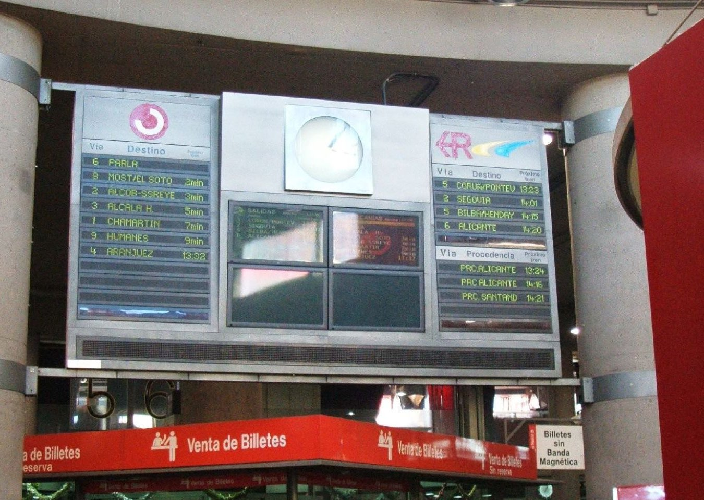

Equipos que aparecen en revistas o fotografías y que todavía no tienen ficha
en el archivo, porque falta algo: el lugar, una fotografía mejor o de quién
es. Cada uno dice qué falta. Si lo sabes o tienes una fotografía,
[abre una incidencia](https://github.com/oierlauzi/destinoteca/issues/new?template=proponer-teleindicador.yml)
o mira [cómo contribuir](../contribuir/).

## Ikusi

### Tablero de salidas de alta velocidad

Un tablero azul titulado «Próximas salidas», con las columnas Tren, Destino,
Hora y Vía en ocho líneas. Solo anuncia trenes «T.A.V.» y Talgo hacia
Córdoba, Sevilla, Málaga, Cádiz y Ciudad Real-Puertollano, por las vías 07 a
09. Los caracteres son del mismo cristal líquido que los
[carteles de andén de Ikusi de Atocha Cercanías](../catalogo/ikusi-anden-atocha/).
Debajo hay una tienda Rail-Press.

Fotografías: Docutren,
[FD_05733](https://archivo.docutren.com/uploads/r/fototeca-2/d/6/8/d68ec69c2aaa8e9cbea6391c3d8c873522671d1b35c0e3aa6707bbe600a9fe32/FD_05733_141.jpg)
y
[FD_05734](https://archivo.docutren.com/uploads/r/fototeca-2/f/3/f/f3ff31e5a6b293d76df2efee7c27c9afb2f41baa9619a8778893244f33d7a5bf/FD_05734_141.jpg).

**Falta:**

- **El lugar.** Por los trenes podría ser Madrid-Puerta de Atocha, pero no
  está comprobado.
- **La fecha.** Que los trenes se llamen «T.A.V.» y no AVE hace pensar en los
  primeros tiempos de la línea Madrid-Sevilla, pero es una suposición.
- **El autor de las fotografías** y sus derechos.

### Tablero del vestíbulo de Atocha Cercanías

En el vestíbulo, entre dos columnas redondas y junto a los tornos de acceso,
colgaba un tablero «Próximas salidas» de cristal líquido, con dos partes:
«Cercanías» a la izquierda y «Regionales y Largo Recorrido» a la derecha.
Tenía unas diez líneas en amarillo y una línea roja debajo. Tiene la misma
división que el [panel de PAGE Ibérica](#panel-del-vestíbulo-de-atocha-cercanías)
que estuvo después en el vestíbulo, y puede que este lo sustituyera.

Fotografía: Docutren,
[FD_05799](https://archivo.docutren.com/uploads/r/fototeca-2/3/0/7/307bcb5e27b6f43415501cee63d9ffe39414cbac95b63af6f6d1c0e9462d1c30/FD_05799_141.jpg).

**Falta:**

- **Una fotografía de más calidad.** La que se conoce es demasiado pequeña
  para leer el tablero.
- **El autor de la fotografía** y sus derechos.

### Carteles de andén de Atocha Cercanías

Los [carteles de andén de Ikusi](../catalogo/ikusi-anden-atocha/) ya tienen
ficha. Una de sus fotografías, la de las vías 2 y 1 con un tren a Ávila, no
dice dónde se tomó.

**Falta:** saber si es Atocha Cercanías u otra estación.

### Otras estaciones

Según *Vía Libre*, Ikusi instaló sistemas de información al público de Renfe
en estas estaciones, de las que no se conocen fotografías:

- Alicante, Zaragoza-El Portillo, Gijón e Irún (marzo de 1992).
- Lorca, Logroño, Cáceres, Mérida y Badajoz, con paneles de cristal líquido
  (diciembre de 1994).

**Falta:** fotografías de cualquiera de ellas.

## PAGE Ibérica

### Panel del vestíbulo de Atocha Cercanías

El gran panel del vestíbulo de Atocha Cercanías, colgado sobre las
taquillas y ya retirado. Reunía en una sola caja gris lo que en otras
estaciones de la [familia](../familias/page-iberica-electromagneticos/)
ocupaba varios carteles:

- **Cercanías**, a la izquierda: diez líneas flip-dot con la vía, el destino
  y los minutos que faltan o la hora, y una fila de LED debajo.
- **Largo Recorrido y Regionales**, a la derecha: cuatro líneas de salidas y
  cuatro de llegadas, cada bloque con su propia fila de LED.
- **En medio**, un reloj y cuatro pantallas de cristal líquido.
- **Abajo**, una fila de LED que ocupa todo el ancho.

Las líneas flip-dot escriben con la misma tipografía que los
[teleindicadores de andén](../catalogo/page-iberica-anden-atocha/) de la
estación, con «min» en minúsculas. Puede que sustituyera al
[tablero de Ikusi](#tablero-del-vestíbulo-de-atocha-cercanías), que tenía la
misma división.

Fotografía: Gonzalo Vázquez Hidalgo. Derechos reservados, reproducida con
crédito.

**Falta:**

- **Cuándo se instaló y cuándo se retiró**, y qué lo sustituyó.
- **Qué mostraban las filas de LED y las pantallas.** En la fotografía, la
  fila de Cercanías y la de abajo están apagadas, y las pantallas apenas se
  leen.
- **Más fotografías**, sobre todo de cerca.

### Tablero de llegadas y salidas en castellano y catalán

Un tablero «Próximas llegadas y salidas / Properes arribades i sortides»,
fotografiado en los anuncios de PAGE Ibérica en *Vía Libre* en 1989. Anuncia
trenes de Lérida, Cervera, Tarragona y Pobla de Segur, lo que apunta a la
estación de Lleida. *Trenes Hoy* (n.º 11) cuenta que Lleida estrenó
teleindicadores automáticos en castellano y catalán.

**Falta:** confirmar que es Lleida y que es el mismo equipo, y fotografías.

### Indicador de vía de Cercanías con destino Orduña

En los mismos anuncios de 1989: un indicador de la vía 6, con la salida y la
llegada, el tipo de tren y la hora («Cercan 20H15»), el destino, «Orduña», y
una fila roja de texto, con la placa de PAGE Ibérica. Por el destino, es del
núcleo de Bilbao. *Trenes Hoy* (n.º 3) cuenta que Bilbao-Abando estrenó
teleindicadores en el vestíbulo y los andenes en 1987.

**Falta:** la estación, y fotografías.

### Alcázar de San Juan

*Trenes Hoy* (n.º 23) menciona una partida de teleindicadores para la
estación de Alcázar de San Juan, a cargo de PAGE Ibérica.

**Falta:** leer la noticia completa, y fotografías.

## Solari

### Barcelona-Sants

Según *Vía Libre* (noviembre de 1989), el sistema de información al público
de Barcelona-Sants lo instaló en 1980 VEMISA, representante de Solari. El
artículo muestra un tablero de paletas «Sortides trajecte llarg» y los doce
indicadores de vía nuevos, de doble cara, con matriz de puntos
electromecánicos y una línea de diodos.

**Falta:** fotografías de los equipos y saber cuándo se retiraron.

## Otros

### Indicadores de andén originales del AVE

Los indicadores que había en los andenes del AVE en sus primeros años.

Fotografías: Docutren,
[FD_04971](https://archivo.docutren.com/uploads/r/fototeca-2/8/d/9/8d91385dec77db1ffdf07191d95792229df75535e2a01844e3e2c3fb071e7030/FD_04971_141.jpg)
y
[FD_06045](https://archivo.docutren.com/uploads/r/fototeca-2/b/f/2/bf29b027a1fc6ed459f7d0e4c8a37d107a1f909033b44aefda10f059dada29fb/FD_06045_141.jpg).

**Falta:**

- **El fabricante** y la tecnología.
- **En qué estaciones** estaban, y cuándo se retiraron.
- **El autor de las fotografías** y sus derechos.

### León

*Trenes Hoy* (n.º 3) da noticia de teleindicadores electrónicos en la
estación de León, con indicadores en los andenes. No son los
[tableros de MP Electronics](../catalogo/mp-electronics-adif-teleindicador/)
de hoy.

**Falta:** quién los fabricó, y fotografías.
